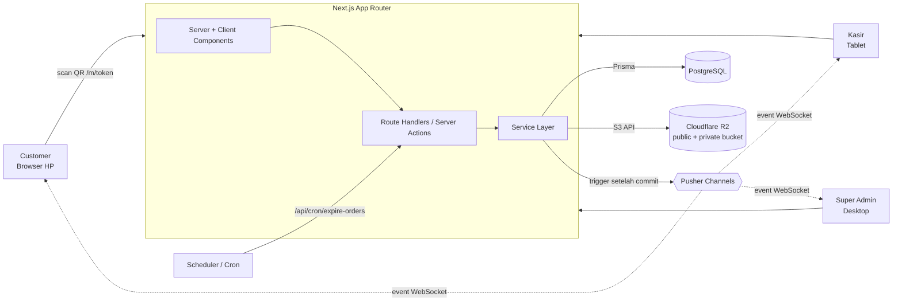
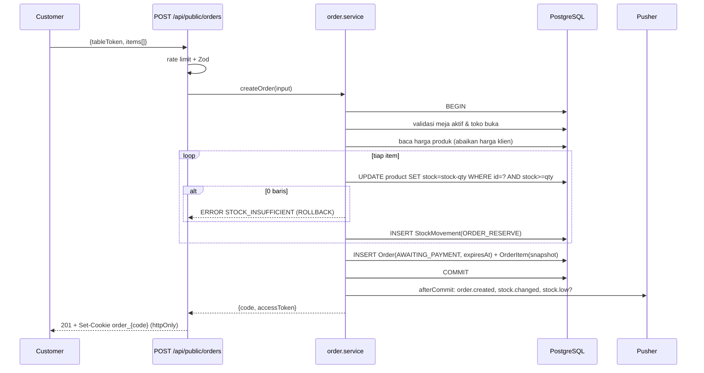
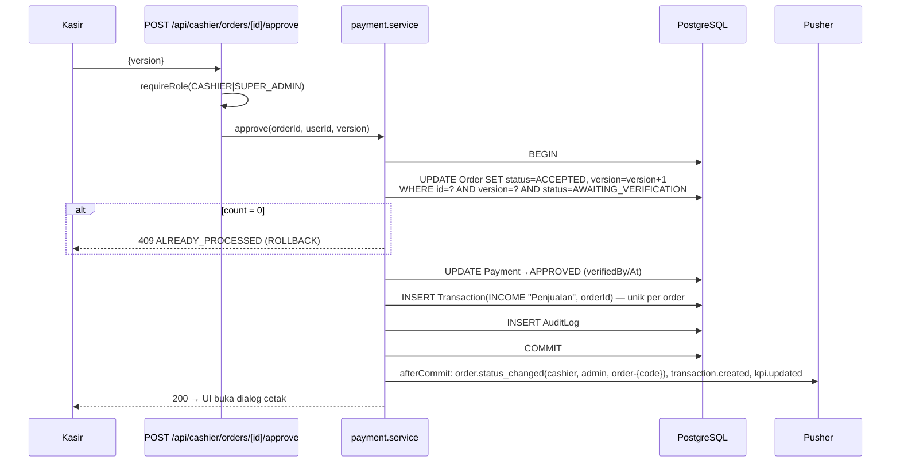
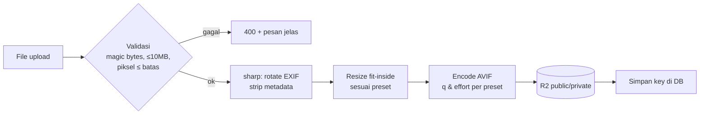
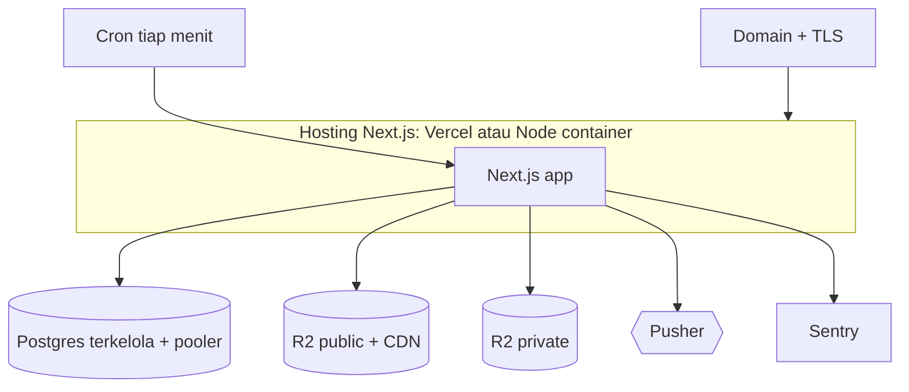

# ARCHITECTURE.md — Arsitektur Sistem Pemesanan F&B via QR Meja

**Versi:** 1.0 | **Tanggal:** 16 November 2026 | **Acuan:** `PRD.md`

Dokumen ini menjelaskan *bagaimana* sistem dibangun: komponen, batas tanggung jawab, alur data, keputusan teknis, dan cara sistem tetap benar saat terjadi konkurensi atau kegagalan.

---

## 1. Gambaran Konteks Sistem



Prinsip: **database adalah sumber kebenaran**; Pusher hanya pemberi sinyal "ada yang berubah", klien lalu mengambil data terbaru dari server.

---

## 2. Gaya Arsitektur

**Modular monolith** pada satu aplikasi Next.js. Alasan: tim kecil, satu deployment, transaksi DB lintas modul (pesanan + stok + keuangan) harus atomik. Modul dipisah secara logis lewat folder dan aturan impor, sehingga dapat dipecah menjadi layanan terpisah bila kelak diperlukan.

### 2.1 Layer dan Aturan Ketergantungan

```
┌───────────────────────────────────────────────┐
│ Presentation   app/**/page.tsx, components/   │  UI, form, hook, store
├───────────────────────────────────────────────┤
│ Transport      app/api/**, server actions     │  auth, parse Zod, panggil service, map error
├───────────────────────────────────────────────┤
│ Application    server/services/*              │  use-case, transaksi, aturan bisnis, event
├───────────────────────────────────────────────┤
│ Domain         server/domain/*                │  state machine, hitung total, kebijakan (murni, tanpa I/O)
├───────────────────────────────────────────────┤
│ Infrastructure lib/db, r2, pusher, image      │  adaptor eksternal
└───────────────────────────────────────────────┘
```

Aturan impor (diperiksa dengan ESLint `no-restricted-imports`):

1. Presentation **tidak boleh** mengimpor `@prisma/client`, `lib/db`, atau `server/*` secara langsung (kecuali server component yang memanggil *query service* read-only).
2. Transport hanya memanggil `services`; tidak berisi logika bisnis.
3. `services` boleh memakai `domain`, `lib/*` (infrastruktur), dan service lain secara terbatas (lihat 2.2).
4. `domain` tidak mengimpor apa pun dari infrastruktur (murni, mudah dites).
5. Tidak ada impor melingkar antar service; komunikasi lintas modul lewat fungsi publik atau event internal.

### 2.2 Modul dan Tanggung Jawab

| Modul (`server/services`) | Tanggung jawab | Bergantung pada |
| --- | --- | --- |
| `auth` | Login, sesi, verifikasi password, tokenVersion | db |
| `catalog` | Kategori, produk, ketersediaan menu publik | db, upload |
| `table` | Meja, token, QR | db |
| `order` | Checkout, state machine, kedaluwarsa, batal | catalog, stock, realtime |
| `payment` | Upload bukti, approve/reject | order, finance, upload, realtime |
| `stock` | Reservasi, rilis, penyesuaian, riwayat | db, realtime |
| `finance` | Transaksi, agregasi laporan | db |
| `cashier` | CRUD kasir, statistik kasir | auth |
| `dashboard` | Agregasi ringkasan | order, finance, stock |
| `upload` | Validasi + konversi AVIF + simpan R2 | lib/image, lib/r2 |
| `realtime` | Emit event bertipe, `afterCommit` | lib/pusher-server |
| `settings` | Konfigurasi aplikasi, metode bayar | db |
| `audit` | Pencatatan AuditLog | db |

---

## 3. Struktur Direktori (final)

```
src/
  app/
    (public)/m/[token]/{page.tsx,cart/page.tsx}
    (public)/order/[code]/page.tsx
    (auth)/login/page.tsx
    admin/(dashboard)/{page,menu,cashiers,stock,finance,tables,settings}/
    cashier/{page.tsx,orders/[id]/{page.tsx,print/page.tsx}}
    api/
      auth/ public/ cashier/ admin/ upload/ pusher/auth/ cron/
  components/{ui,admin,cashier,customer,shared}/
  server/
    domain/        order-state.ts  pricing.ts  stock-policy.ts
    services/      order.ts  payment.ts  stock.ts  finance.ts ...
    queries/       read-model untuk dashboard (SQL agregat)
  lib/
    db.ts env.ts session.ts auth.ts rbac.ts
    r2.ts image.ts qr.ts
    pusher-server.ts pusher-client.ts realtime-events.ts
    ratelimit.ts errors.ts logger.ts utils.ts
    validators/
  hooks/ stores/ types/
prisma/ schema.prisma seed.ts migrations/
tests/ unit/ integration/ e2e/
```

---

## 4. Alur Kunci (Sequence)

### 4.1 Checkout (Customer → Pesanan + Reservasi Stok)



### 4.2 Upload Bukti Pembayaran

```mermaid
sequenceDiagram
  participant U as Customer
  participant API as POST /api/public/orders/[code]/payment
  participant UP as upload.service
  participant R2 as R2 (private)
  participant S as payment.service
  participant DB as PostgreSQL
  participant P as Pusher

  U->>API: multipart(file) + cookie accessToken
  API->>S: submitProof(code, token, file)
  S->>DB: cek token, status ∈ {AWAITING_PAYMENT, PAYMENT_REJECTED}, attempt ≤ max
  S->>UP: processAndStore(file, preset=proof)
  UP->>UP: magic bytes, ukuran, rotate, resize, AVIF
  UP->>R2: putObject(proofs/yyyy/mm/{nanoid}.avif)
  S->>DB: BEGIN; INSERT Payment(PENDING); UPDATE Order→AWAITING_VERIFICATION (version++); COMMIT
  S->>P: afterCommit: payment.uploaded, order.status_changed
  S-->>U: 200
  Note over DB,R2: Bila DB gagal setelah upload, objek R2 dihapus (kompensasi) atau dibersihkan job orphan
```

### 4.3 Approve Pembayaran (Kasir)



### 4.4 Kedaluwarsa Pesanan (Cron)

1. Cron memanggil `GET /api/cron/expire-orders` dengan header `Authorization: Bearer CRON_SECRET`.
2. Service memilih pesanan `AWAITING_PAYMENT` / `PAYMENT_REJECTED` dengan `expiresAt < now()` menggunakan `FOR UPDATE SKIP LOCKED` (aman bila cron tumpang tindih).
3. Per pesanan (transaksi sendiri): set `CANCELLED`, kembalikan stok (`ORDER_RELEASE`), emit event.
4. Idempoten: pesanan yang sudah `CANCELLED` tidak diproses ulang.

---

## 5. Arsitektur Realtime

### 5.1 Pola

**Signal + Refetch.** Event hanya membawa `id` dan ringkasan; klien memanggil `queryClient.invalidateQueries([...])`. Keuntungan: tidak ada state ganda, aman dari event hilang/urutan terbalik, payload kecil (batas Pusher 10 KB).

### 5.2 Peta Channel → Konsumen

| Channel | Konsumen | Event |
| --- | --- | --- |
| `private-cashier` | Layar kasir, admin | `order.created`, `payment.uploaded`, `order.status_changed` |
| `private-admin` | Dashboard admin | semua event admin, `stock.low`, `transaction.created`, `kpi.updated` |
| `private-order-{code}` | Halaman status customer | `order.status_changed` |
| `private-table-{token}` | Menu customer | `stock.changed` |
| `private-user-{id}` | Sesi kasir tertentu | `user.deactivated` |

### 5.3 Jaminan dan Penanganan Kegagalan

- **Emit setelah commit** lewat `runInTransaction` + `after()` (outbox in-memory per transaksi): callback hanya dijalankan setelah transaksi commit, dibuang saat rollback, dan pemanggilan service bersarang memakai transaksi induk.
- Emit **gagal tidak menggagalkan request** (log + metrik). Pemulihan: klien melakukan refetch saat reconnect dan polling cadangan 30 detik saat koneksi `unavailable`.
- **Batas outbox in-memory:** bila proses mati tepat setelah commit namun sebelum callback selesai, event bisa hilang. **OutboxEvent** (tabel ditulis dalam transaksi yang sama, worker mengirim ke Pusher dengan retry) adalah perbaikan lanjutan yang direkomendasikan bila kehilangan notifikasi kasir tidak dapat diterima; belum diimplementasikan.
- **Debounce invalidasi** 300-500 ms pada dashboard agar rentetan event tidak membanjiri query.
- **Otorisasi channel** di `/api/pusher/auth`: sesi staff divalidasi ke DB (`isActive` + `tokenVersion`) lewat jalur yang sama dengan `requireRole`; `private-order-{code}` membandingkan accessToken pesanan secara timing-safe; `private-table-{token}` wajib meja aktif; `private-user-{id}` wajib id sesi sendiri. Kegagalan selalu 403 generik.
- **Pemutusan sesi kasir:** event `user.deactivated` dikirim ke `private-user-{id}` setelah commit; klien logout dan memutus koneksi Pusher. `terminateUserConnections` Pusher tidak dipakai karena aplikasi tidak memakai Pusher user authentication, sehingga koneksi yang sudah terbuka tetap hidup sampai klien memutus. Karena itu payload event sensitif hanya berisi id/username, bukan data rahasia, dan otorisasi tidak boleh bergantung pada kerahasiaan channel.

---

## 6. Arsitektur Data

### 6.1 Prinsip

- Rupiah disimpan sebagai `Int` (tanpa desimal).
- **Snapshot** nama & harga di `OrderItem`; perubahan harga produk tidak mengubah riwayat.
- Waktu disimpan UTC; konversi ke WIB saat tampil dan saat pengelompokan harian (`AT TIME ZONE 'Asia/Jakarta'`).
- Soft delete (`deletedAt`) untuk entitas yang punya relasi riwayat.

### 6.2 Indeks Penting

| Tabel | Indeks | Tujuan |
| --- | --- | --- |
| Order | `(status, createdAt)` | Antrean kasir |
| Order | `code` unik | Lacak pesanan |
| Payment | `(orderId)` | Riwayat bukti |
| Transaction | `(type, occurredAt)` | Laporan keuangan |
| StockMovement | `(productId, createdAt)` | Riwayat stok |
| Product | `(categoryId, isActive)` | Daftar menu |
| AuditLog | `(entity, entityId)` | Telusur audit |

### 6.3 Transaksi dan Konkurensi

| Risiko | Mekanisme |
| --- | --- |
| Oversell stok | `UPDATE ... SET stock = stock - :q WHERE stock >= :q` (atomik), cek jumlah baris |
| Dua kasir memproses pesanan sama | Optimistic locking: `version` + `status` pada klausa WHERE |
| Pemasukan ganda | Unik `(orderId, category)` pada Transaction + operasi dalam transaksi yang sama dengan perubahan status |
| Cron ganda | `FOR UPDATE SKIP LOCKED` + transisi idempoten |
| Kode pesanan bentrok | Unik `code`, retry saat konflik |
| Deadlock multi-item | Urutkan `productId` sebelum update stok |

Isolation level default `READ COMMITTED` sudah memadai karena semua invarian dijaga predikat atomik di klausa WHERE.

### 6.4 Agregasi Dashboard

Read-model berupa query SQL agregat (`GROUP BY date_trunc`) di `server/queries/`, dibungkus cache 15 detik (`unstable_cache` dengan tag `dashboard`) dan di-`revalidateTag` saat event relevan. Bila data > ±1 juta pesanan, tambahkan tabel ringkasan harian (`DailyStat`) yang diperbarui saat approve.

---

## 7. Arsitektur Penyimpanan (R2)

| Bucket | Isi | Akses | Prefix |
| --- | --- | --- | --- |
| `fnb-public` | Gambar menu, thumbnail, QRIS, logo | Publik via domain kustom/CDN, cache panjang (`immutable`) | `products/`, `thumbs/`, `payment-methods/`, `branding/` |
| `fnb-private` | Bukti bayar, lampiran pengeluaran | Privat; presigned GET 60 detik oleh endpoint terotorisasi | `proofs/yyyy/mm/`, `expenses/` |

Aturan: nama objek acak (`nanoid`), format selalu `.avif`, `Content-Type: image/avif`, `Cache-Control` publik `public, max-age=31536000, immutable`. Job mingguan membersihkan objek yatim (tidak direferensikan DB) berumur > 24 jam.

### 7.1 Pipeline Gambar



Catatan platform: `sharp` memakai binary native; pastikan target deploy didukung. Pada Vercel, batas body ±4,5 MB → kompres sisi klien atau gunakan hosting Node untuk batas 10 MB.

---

## 8. Autentikasi dan Otorisasi

- **Staf:** cookie sesi httpOnly berisi JWT (`jose`, HS256) `{sub, role, tokenVersion}`; setiap request sensitif memverifikasi user aktif dan `tokenVersion` di DB (dengan cache sangat singkat 10–30 detik). Menaikkan `tokenVersion` = logout paksa semua sesi user.
- **Customer:** tanpa akun. Identitas = `tableToken` (membuka menu) dan `accessToken` pesanan (cookie httpOnly `order_{code}`) untuk melihat/mengubah pesanannya.
- **RBAC:** matriks di `lib/rbac.ts`; `requireRole()` dipanggil di setiap handler. Middleware hanya lapisan pertama (redirect cepat).

| Sumber daya | SUPER_ADMIN | CASHIER | Customer |
| --- | --- | --- | --- |
| Dashboard/CRUD admin | ✔ | ✘ | ✘ |
| Antrean & verifikasi | ✔ | ✔ | ✘ |
| Menu publik | ✔ | ✔ | ✔ (via token meja) |
| Pesanan sendiri | ✔ | ✔ | ✔ (via accessToken) |
| Bukti bayar | ✔ | ✔ | ✘ (hanya unggah) |

---

## 9. Penanganan Error

- Kelas `AppError(code, httpStatus, message, details?)` dengan kode stabil: `VALIDATION_ERROR`, `UNAUTHENTICATED`, `FORBIDDEN`, `NOT_FOUND`, `CONFLICT`, `ALREADY_PROCESSED`, `STOCK_INSUFFICIENT`, `ORDER_EXPIRED`, `INVALID_TRANSITION`, `RATE_LIMITED`, `UPLOAD_INVALID`.
- Format respons seragam: `{ error: { code, message, fields? } }`; respons sukses `{ data }`.
- Error tak terduga: dicatat (Sentry) dengan `requestId`, respons generik `INTERNAL`.
- Klien memetakan kode ke pesan Indonesia yang ramah (lihat DESIGN-SYSTEM bagian copy).

---

## 10. Caching dan Performa

| Data | Strategi |
| --- | --- |
| Menu publik | `revalidateTag('menu')` saat produk/stok berubah; stok live dari event Pusher |
| Gambar menu | CDN R2, immutable, `next/image` + lazy load |
| Dashboard | Cache 15 dtk + invalidasi tag |
| Sesi | Cache in-memory 10–30 dtk untuk pengecekan user aktif |
| Bundle | Dynamic import Recharts, viewer zoom, QR |

Target: LCP < 2,5 dtk (4G), event→UI < 1 dtk p95, query dashboard < 300 ms p95.

---

## 11. Observabilitas

- **Log terstruktur** (JSON): `requestId, userId, role, route, durationMs, errorCode`. Tanpa data sensitif (password, accessToken, URL presigned).
- **Metrik:** jumlah pesanan/menit, rasio gagal emit Pusher, durasi konversi AVIF, error rate per endpoint.
- **Error tracking:** Sentry (server + klien).
- **Uptime:** health check `GET /api/health` (cek DB; opsional R2/Pusher non-blocking).
- **Audit bisnis:** `AuditLog` untuk approve/reject, ubah stok, CRUD kasir, keuangan, regenerasi token.

---

## 12. Topologi Deployment



- **Lingkungan:** `local`, `staging`, `production`; database & bucket & app Pusher terpisah per lingkungan.
- **CI/CD:** push → typecheck, lint, unit/integration, build → `prisma migrate deploy` → deploy → smoke test E2E.
- **Koneksi DB:** gunakan pooler (PgBouncer/Neon pooler) untuk `DATABASE_URL`, koneksi langsung untuk migrasi (`DIRECT_URL`).
- **Backup:** snapshot harian + PITR bila tersedia; uji restore berkala.
- **Rollback:** deploy sebelumnya dapat dipulihkan; migrasi bersifat *expand → migrate → contract* agar kompatibel mundur.

---

## 13. Skalabilitas

| Beban | Langkah |
| --- | --- |
| Ratusan pengunjung bersamaan | Cukup konfigurasi dasar; cache menu |
| Ribuan pesanan/hari | Indeks tepat, `DailyStat`, arsip pesanan lama |
| Banyak kasir/layar | Batas koneksi Pusher sesuai paket; satu koneksi per tab |
| Multi-cabang (v2) | Tambah `Branch` + `branchId` di semua entitas, channel per cabang |

---

## 14. Catatan Keputusan Arsitektur (ADR)

| # | Keputusan | Alasan | Konsekuensi |
| --- | --- | --- | --- |
| 1 | Modular monolith Next.js | Sederhana, transaksi lintas modul atomik | Skala vertikal dulu; batas modul dijaga disiplin impor |
| 2 | Service layer di antara handler dan Prisma | Logika bisnis terpusat & teruji | Boilerplate sedikit lebih banyak |
| 3 | Pusher "signal + refetch" | Tahan event hilang, payload kecil | Satu request ekstra per event |
| 4 | Reservasi stok saat checkout | Mencegah bayar tanpa stok | Perlu cron kedaluwarsa & rilis stok |
| 5 | Optimistic locking `version` | Cegah double-approve tanpa lock panjang | Klien harus mengirim `version` |
| 6 | AVIF di server (sharp) | Ukuran kecil, kontrol penuh, bukti bayar seragam | Beban CPU saat upload; batas body hosting |
| 7 | Bucket privat + presigned URL untuk bukti | Data pembayaran sensitif | Endpoint tambahan untuk URL |
| 8 | Customer tanpa akun (token meja + accessToken) | Friksi minimal | Pesanan hanya dapat dilacak di perangkat/cookie asal; sediakan input kode + akses |
| 9 | Verifikasi pembayaran manual | Tanpa biaya gateway, sesuai kebutuhan | Ada risiko bukti palsu → kasir wajib cek mutasi rekening; gateway di v2 |
| 10 | Rupiah sebagai Int | Tanpa galat desimal | Tidak mendukung pecahan sen (tidak diperlukan) |

---

## 15. Matriks Kegagalan (Failure Modes)

| Kegagalan | Dampak | Mitigasi |
| --- | --- | --- |
| Pusher down | Tidak ada update live | Polling cadangan 30 dtk, refetch saat reconnect, indikator koneksi merah |
| R2 gagal saat upload bukti | Upload gagal | Pesan ulang-coba; tidak mengubah status pesanan |
| DB gagal setelah R2 sukses | Objek yatim | Kompensasi hapus + job pembersih |
| Kasir tutup tab saat setuju | Tidak ada | Aksi atomik di server; status tersimpan |
| Dua kasir klik bersamaan | Konflik | Optimistic lock → pesan "sudah diproses" |
| Cron terlambat | Stok tertahan sementara | Pengecekan `expiresAt` juga dilakukan saat pesanan dibuka/dibayar |
| Customer ganti perangkat | Kehilangan cookie | Halaman `/order/[code]` meminta kode akses |
| Lonjakan upload | CPU naik | Rate limit, batas ukuran, antrean/worker bila perlu |
